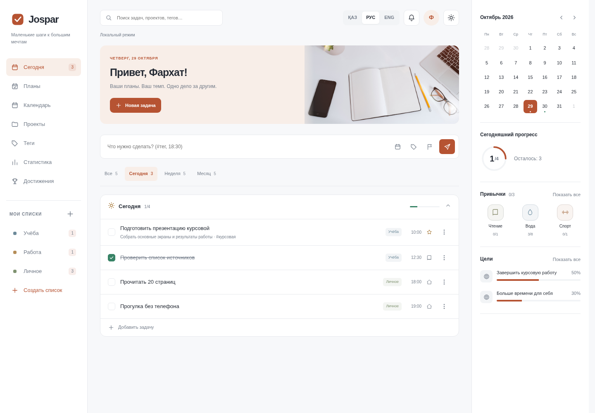

# Jospar

Планировщик задач, проектов, привычек и целей. Русский, казахский и английский интерфейс.

## Локальный запуск
Node.js 22+ (Docker использует Node 22).

```sh
npm run setup
npm test
npm start
```

Откройте http://localhost:8085. Без Firebase работает явно обозначенное локальное демо: аккаунты, задачи и коды подтверждения находятся только в браузере. Это не безопасная серверная авторизация и не отправка SMS. Не используйте реальные пароли в демо. Экспортируйте данные через меню профиля → Настройки → Экспорт данных. Импорт заменяет данные после подтверждения. Очистка браузера удаляет локальное хранилище.

## Firebase: реальные аккаунты и облачные данные
1. Создайте Firebase-проект и Firestore; включите Email/Password и Phone в Authentication. Настройте разрешённые домены, SMS-регионы, квоты и тариф. Используйте тестовые номера для разработки.
2. Поместите публичный Web app config в `public/config.js` вместо null. Это публичная конфигурация, не service-account key.
3. Передайте серверу `JOSPAR_MODE=firebase` и Application Default Credentials через GOOGLE_APPLICATION_CREDENTIALS либо identity Cloud Run. Никогда не кладите ключ в public или Git.
4. Запустите `JOSPAR_MODE=firebase npm start`. `/api/health` проверяет доступ к Firestore. Проверьте реальную регистрацию, подтверждение почты, восстановление пароля и SMS на вашем проекте до публикации.
5. Разверните закрытые правила Firestore: `firebase deploy --only firestore:rules --project YOUR_PROJECT`.
6. Для Cloud Run собирайте Dockerfile или задайте JOSPAR_MODE=firebase при развёртывании. Firebase Hosting использует rewrite на сервис jospar в europe-west1 из firebase.json. Примените `firebase deploy --only hosting --project YOUR_PROJECT` после создания сервиса и настройки его identity/переменных.

Восстановление пароля отправляет письмо Firebase с защищённой одноразовой ссылкой; установку нового пароля выполняет стандартная Firebase Action page. В проект также включена собственная `/reset.html`: для её использования задайте Custom action URL в шаблоне Password reset Firebase. Срок жизни и однократность проверяет Firebase. В шаблоне письма укажите адрес возврата на ваш сайт. Вход по телефону использует SMS, пароль для него не нужен.

Письма, SMS, Firestore и production-развёртывание требуют внешней конфигурации и не входят в локальный smoke-test. Секретов в проекте нет. При ошибке загрузки Firebase демо автоматически не включается.

## Данные и сохранение
Сервер проверяет ID token, структуру/размер данных и версию записи в транзакции. Параллельная устаревшая запись получает 409. При конфликте сначала экспортируйте текущие изменения, обновите страницу и объедините их вручную; автоматическое слияние отсутствует. Клиент сохраняет локальную страховочную копию в ключе `jospar.backup.<uid>`, показывает ошибку и предлагает повтор. Полный офлайн-sync облачного режима не реализован.

Цели поддерживают ручной процент и связь с проектом (прогресс по выполненным задачам проекта). Колокольчик — список задач на сегодня и просроченных, и напоминания браузера при открытой странице (включаются вручную в настройках); это не фоновая push-доставка. Напоминания при закрытом сайте требуют сервера push-доставки. Статистика рассчитывается по текущим задачам; полученные достижения сохраняются и после удаления задач.

## Docker
```sh
docker compose up --build
```
Запускает локальный режим без ключей. Для Firebase передайте identity через безопасный механизм платформы/readonly volume вне репозитория и настройте JOSPAR_MODE=firebase.

## Проверки
`npm test` — тесты схемы данных. `node tests/browser.cjs` — регрессия Chromium, требует установленного playwright и Chromium, запущенного npm start; задайте CHROMIUM_PATH при другом расположении браузера. Проверяет регистрацию, задачи, сохранение, черновики, мобильные размеры, сохранность привычек и доступность диалога. Не вызывает внешние SMS и не отправляет письма.

Дополнительная проверка формы сброса: `node tests/reset.cjs`. В ней Firebase SDK подменён: проверяются состояния экрана, а не реальная доставка письма.

## Новый интерфейс (версия 3)
Светлая тема по умолчанию, тёмная доступна в меню. Встроенная фотография рабочего стола хранится в `public/assets/`; источник указан в CREDITS.md. Объёмные канцелярские объекты на регистрации выполнены в CSS. Подписи казахского календаря заданы явно, независимо от поддержки локали браузером.

Проверка адаптивности: `node tests/design.cjs` (75 сочетаний: 5 размеров × 3 языка × 5 экранов). Путь для снимков задаётся через SCREENSHOT_DIR, по умолчанию — временный каталог. Скриншоты используют синтетические данные, не добавляемые обычным пользователям.

Чтобы обновить установленную версию, остановите сервер через Ctrl+C и используйте свежую папку из ZIP. Для Docker: `docker compose up --build -d`. Адрес остаётся http://localhost:8085. Если видите старый дизайн, обновите страницу через Ctrl+F5 и убедитесь, что запускаете свежую папку проекта.

На Windows можно запустить `start-local.cmd` из папки проекта: он сам выберет правильную рабочую папку, проверит Node.js и при необходимости установит зависимости. После запуска откройте http://localhost:8085. Скрипт подготовлен для Windows, но в Linux-среде его выполнение не проверялось.

## Скриншоты нового дизайна

Снимки сделаны в браузере с тестовыми данными. Они не добавляются в рабочий аккаунт.



[Регистрация с объёмными объектами](docs/screenshots/registration.png) · [Проекты](docs/screenshots/projects.png) · [Мобильный экран](docs/screenshots/mobile.png)

## Дополнения 4: входящие, поиск и уведомления

Оформление основных экранов сохранено; в опроснике заменён только фон. Новая фотография — `public/assets/survey-desk.jpg`. Источник указан в CREDITS.md.

- **Входящие**: задачи без проекта. Быстрый ввод в этой вкладке создаёт именно такую задачу. Для переноса откройте задачу и выберите проект/дату.
- **Предстоящие**: просроченные, ближайшие 14 дней и более поздние задачи. Кнопка «Отображение» управляет сортировкой и показом выполненных.
- **Поиск**: Ctrl+K (на Mac ⌘K) открывает задачи, проекты, последние разделы и команды; ↑/↓ выбирают результат, Enter открывает, Esc закрывает.
- **Условия поиска**: `сегодня p1`, `завтра`, `просрочено`, `@метка`, `#проект`, `выполнено`, `активные`, `без_даты`; английские и казахские варианты основных слов тоже поддерживаются. Несколько условий объединяются через И.
- **Фильтры и метки**: сохранённые запросы, готовые фильтры и поиск по меткам.
- **Уведомления**: сроки задач и история создания/изменения/выполнения/удаления, вкладки «Все / Не прочитано», прочтение одного или всех. История ограничена последними 200 действиями. Отметки прочитанного сохраняются. Это уведомления личного пространства, не изменения других пользователей.
- **Меню профиля / Ещё**: отчёты за 7/30 дней или всё время, CSV выбранного периода, системная печать, описание обновлений, справка и ручная синхронизация.
- **Синхронизация**: сначала дожидается записи, затем перечитывает сохранённые данные. При ошибке записи не заменяет несохранённое состояние. В демо это только браузер; облачная запись требует Firebase.
- **Команды**: локальная демонстрация создания команды, списка участников и группировки проектов. Приглашения и общий доступ между аккаунтами не реализованы. Платёжных и Pro-функций нет.
- Горячие клавиши: Q — задача; G, затем I/T/U/V/A — Входящие/Сегодня/Предстоящие/Фильтры/Отчёты.

Новые данные входят в существующий экспорт/импорт и проверяются серверной схемой. Старые сохранённые данные совместимы. Новые функции выделены в `features.js` и `features.css`.

Проверки: `npm test` — 11 проверок сервера, схемы и логики поиска/уведомлений; `node tests/features.cjs` — новые пользовательские сценарии и 90 сочетаний размера/языка/экрана. Браузерные проверки запускаются при работающем сервере на 8085; требуют Chromium. Печать в тесте проверяет вызов браузерного диалога, а не физический принтер.

Примеры дополнений: [фон опросника](docs/screenshots/survey-background.png) · [поиск команд](docs/screenshots/command-search.png) · [уведомления](docs/screenshots/notifications.png) · [предстоящие](docs/screenshots/upcoming.png). Снимки используют тестовый аккаунт.
