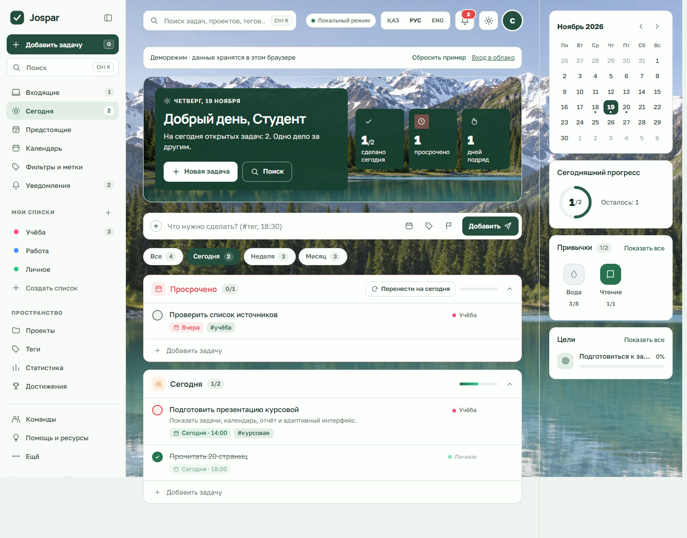

# Jospar

Учебный веб-планировщик задач, проектов, привычек и целей. Текущая версия — **3.3.0**. Интерфейс доступен на русском, казахском и английском языках.

**[Открыть полную версию](https://jospar-fcaa0-v3.web.app/app.html)** · **[Попробовать демо](https://jospar-fcaa0-v3.web.app/demo.html)**

## Возможности

- Задачи с датой, временем, приоритетом и тегами; календарь, поиск и фильтры.
- Привычки, цели, статистика, CSV-отчёты и резервные копии JSON.
- Вход по почте с подтверждением email и через Google.
- Команды, одноразовые приглашения и чат между участниками.
- Напоминания и сообщения внутри сайта с плавным исчезновением через 10 секунд.
- Три темы оформления: «После пар», «Рабочая тетрадь», «Свой горизонт»; светлый и тёмный режимы.
- Адаптивный интерфейс; локальное демо работает офлайн после первого полного открытия.

## Внешний вид



Другие варианты: [«После пар»](docs/screenshots/themes/campus-light-1440.png), [«Рабочая тетрадь»](docs/screenshots/themes/notebook-light-1440.png), [выбор темы](docs/screenshots/themes/picker-horizon.png). На скриншотах — демонстрационные данные.

## Локальный запуск

Нужен **Node.js 24.12+**.

```sh
npm run setup
npm start
```

Демо: http://localhost:8089/demo.html. В Windows также доступны `start-local.cmd` и `start-demo.cmd`.

Облачный режим обращается к Firebase и требует интернета. Рабочая база защищена App Check: для локальной разработки используйте демо или Firebase Emulator. Доступ к рабочей базе с localhost требует отдельного App Check debug provider; секретный debug token нельзя добавлять в публичные файлы или Git.

Демо хранит данные только в браузере. В нём нет реальных аккаунтов Google, общей переписки, писем или SMS. Обычный режим использует Firebase Authentication и Cloud Firestore.

## Проверки

```sh
npm test
npm run build
npm run test:browser
npm run test:firebase
npm audit
npm audit --prefix server
```

Браузерные проверки сами запускают временный сервер. Для них нужен Edge/Chrome/Chromium; путь можно задать через `CHROMIUM_PATH`. Облачные UI-тесты используют явно подменённый SDK и не отправляют письма/SMS. Правила базы проверяются настоящим локальным эмулятором `demo-jospar`; для него нужна Java 21. Эмулятор выбирает свободные порты и не обращается к рабочей базе.

Подтверждены: 26 обычных тестов, 11 браузерных наборов и 6 групп проверок Firestore. GitHub Actions выполняет чистую установку, сборку, обычные тесты, правила Firestore на эмуляторе и npm audit; ключей публикации в workflow нет.

## Безопасность и бесплатный тариф

- Firebase SDK 13.4.0 и CLI 15.37.0 закреплены в lock-файле. Сборка проверяет совпадение установленных версий с манифестом.
- Правила Firestore ограничивают доступ владельцем личных данных и участниками команды.
- Для Firestore включён строгий App Check с reCAPTCHA Enterprise, привязанный к доменам v3. Владелец разрешил отключить доступ старых клиентов v1/v2 без App Check.
- Серверные ограничения на аккаунт: сообщение раз в 2 секунды, приглашение раз в 10 секунд, команда раз в 60 секунд. Запись и ограничитель отправляются атомарно.
- После успешного облачного выхода локальные копии текущего аккаунта удаляются. Тема, язык, данные демо и других аккаунтов сохраняются. Ошибка очистки сообщается пользователю.
- Платный тариф не подключён. reCAPTCHA имеет бесплатную квоту 10 000 оценок в месяц; App Check TTL — 24 часа. При исчерпании квот доступ может ограничиться.

[Описание хранения и удаления данных](https://jospar-fcaa0-v3.web.app/privacy.html) · [Сообщить о проблеме безопасности](SECURITY.md) · [Результаты проверок](docs/SECURITY_3_3_0_CHECKS.json)

App Check и тесты не гарантируют абсолютную защиту. История команд может сохраняться после удаления аккаунта; отдельные запросы удаления обрабатываются поддержкой. SMS и фоновая push-доставка в этой бесплатной сборке не предлагаются.

## Структура

- `public/` — интерфейс, собранный SDK, стили, темы и офлайн-демо.
- `src/` — исходники Firebase SDK entry points.
- `server/` — локальный Express-сервер; старый серверный API отключён.
- `firestore.rules` — серверные ограничения доступа и частоты запросов.
- `scripts/` — проверка установки, сборочные entry points и лицензии.
- `tests/` — проверки логики, интерфейса и правил Firestore.
- `docs/` — инструкции, история изменений и подтверждения проверок.

## Публикация

```sh
npm run deploy:v3
```

Команда публикует только Hosting-цель `v3`. Правила Firestore и App Check настраиваются отдельно; база и аккаунты остаются в Firebase-проекте `jospar-fcaa0`. Не ослабляйте правила ради запуска старого клиента. `.env`, `node_modules`, логи, приватные сервисные ключи и debug tokens в репозиторий не включаются.

## Лицензии и материалы

Полные тексты лицензий библиотек, включённых в браузерную сборку: [third-party notices](public/licenses/THIRD_PARTY_NOTICES.txt). Они автоматически собираются для фактически использованных пакетов. Лицензии шрифтов находятся в `public/assets/fonts/*-OFL.txt`. Источники фотографий — [CREDITS](public/assets/CREDITS.md); созданные фоны описаны в [THEME_ASSETS](docs/THEME_ASSETS.json).

Лицензии сторонних компонентов не предоставляют отдельную лицензию на оригинальный код и оформление Jospar. Возможность их повторного использования согласуется с авторами.
